# 작은 숲 연구소 15.12.2 — 숲 배경 재설계와 생활 공간

완료 기록일: **2026-10-23**. 실제 저장소: C:/Users/User/Documents/GitHub/eco-system. 시작 HEAD: `79f8a66402063ab76afed48d35a9079cf3d48c32`. 시작 작업 트리는 깨끗했다. 중단 전 만든 숲과 검사 자료를 이어받아 확인했고 별도 게임 구현본·ZIP은 만들지 않았다.

실제 게임이 읽는 **assets/images/forest.svg**를 다시 그렸다. 먼 숲·독립된 세 나무·드러난 가지·수관·관목·열린 숲 바닥·낙엽·토양 단면이 이어지는 구도로 바꾸었다. 생물24종 SVG/156뷰와 모든 런타임 data/js/css/index, 생태·배치·경제·저장 계약을 보존했다. [7장면 전후 비교](docs/forest-background-qa.html)와 [검사 결과](tests/forest-background.browser-results.json)를 함께 확인한다.

## A. 기존 배경의 문제와 분석

요청한 8개 문서(STAGE15_12_1, STAGE15_12, STAGE15_11_6, STAGE15_11_5 보고서·FOREST_SPATIAL_LAYOUT·FOREST_SPECIES·ARCHITECTURE·README), 기존 forest.svg, 생물 자산·생성 원본, forest-spaces/habitat-anchors/habitat-presentation, organism-layer/forest-view/render와 배치·선택·모션·CSS를 대조했다. 작업 전 실제 게임의 7장면×5크기 화면과 수관/줄기 범위 겹침을 보존했다.

| 실제 기존 화면에서 확인한 점 | 개선 방향 |
|---|---|
| 같은 tree 도형을 크기만 바꿔 두 번 사용하며 넓고 둥근 수관이 반복됨 | 세 나무의 줄기·갈라짐·수관을 각각 작성 |
| 큰 수관이 가지를 대부분 덮어 새와 다람쥐의 지지면이 잘 읽히지 않음 | 잎 사이 빈 곳과 드러난 가지를 기존 수관 범위에 연결 |
| 오른쪽 작은 나무는 줄기 끝이 지면 위에서 끊김 | 기존 (1161,221)을 지나 지면으로 내려가는 줄기와 뿌리 |
| 지표와 단면 경계가 좁고, 낙엽은 규칙적인 삼각형에 가까움 | 넓은 저대비 활동 바닥·불규칙 낙엽 묶음·얕은 부식층과 별도 단면 |
| 주 나무의 짙은 녹색과 단순 먼 실루엣의 대비가 커 실제 작은 생물과 경쟁함 | 전체 채도를 낮추고 낮은 대비의 먼 숲과 밝은 지면으로 구분 |
| 토양에는 뿌리가 이미 있었지만 나무·지면·주변 풀과의 연결이 약함 | 뿌리 방향을 세 줄기 아래에 맞추고 관목/풀/흙층을 같은 구도로 연결 |

기존 배경이 모든 부분에서 잘못되었다고 보지는 않았다. 원격 이미지·필터가 없는 SVG, 이미 정해진 전체 숲 좌표, 지면 굴곡과 토양 단면은 유지할 기반이었다.

## B. 최종 그래픽 스타일

친근한 관찰 도감과 2D 숲 게임 사이의 벡터 그림으로 정리했다. 강한 검은 테두리 대신 회갈색 나무 선과 회녹색 잎, 밝은 황갈색 바닥을 사용했다. 먼 숲은 낮은 명암 차이로, 주요 나무는 겹친 수관·밝은 줄기 면·몇 개의 수피 선으로 깊이를 표현한다. 실제 생물의 더 짙은 윤곽과 종별 체색이 남도록 배경의 채도를 제한했다.

완전한 원형 수관과 직선 기둥 반복을 줄였고 가지가 시작되는 곳에서 줄기 굵기를 바꾸었다. 잎은 소수의 비대칭 붓 모양을 크기·방향이 다른 위치에 사용한다. 무작위 생성·반복 texture 패턴·사진·대형 배경 래스터·외부 원격 자산은 없다. sky/floor/soil의 정적 linearGradient 세 개 외에 blur/filter/파티클/날씨 모션은 사용하지 않았다.

## C. 숲 공간별 개선

| 공간 | 새 그림 | 기존 게임과의 관계 |
|---|---|---|
| 하늘·먼 숲 | 연한 자연광, 서로 다른 높이의 뒤 나무와 낮은 숲 윤곽 | 장식이며 실제 생산자/카드가 아님 |
| 수관 | 비대칭으로 겹친 잎 덩어리와 빈 틈, 잔가지 | 기존 canopy 대표 범위 유지 |
| 가지·나무줄기 | 독립된 세 줄기, 굽이·밝은 면·갈라진 가지·낮은 뿌리 | 기존6개 중심을 실제 목재 그림이 통과 |
| 풀·관목 | 키와 방향이 다른 낮은 잎, 뿌리 주변의 작은 덤불 | 실제 강아지풀·팽나무·소나무 먹이를 대체하지 않음 |
| 숲 바닥 | planting contour 앞쪽의 밝고 열린 활동 띠 | 모델의 ground/activity/간격/장애물 수치 불변 |
| 낙엽층 | 크기·방향이 다른 작은 잎 묶음과 몇 개의 가지 흔적 | 유기물 원장이나 litter 자원을 새로 생성하지 않음 |
| 토양 단면 | 얕은 어두운 층·갈색 흙·분지 뿌리·소수의 입자 | 참지렁이의 기존 표시 공간. 새 지하 모델/자원 없음 |

토양 층의 색과 단면 굴곡은 생활 공간 설명을 위한 도식이며 모든 실제 숲의 토양 층위가 같다는 뜻은 아니다. 새 버섯·열매·거미줄·연못·죽은 목재 객체를 배경에 추가하지 않았다.

## D. 왼쪽·중앙·오른쪽 구도

왼쪽은 넓게 퍼지는 큰 수관과 노출된 갈래 가지, 중앙은 조금 작은 나무와 넓은 관찰 바닥, 오른쪽은 화면 바깥으로 이어지는 수관과 지면까지 굽어 내려오는 줄기로 구성했다. 세 나무가 같은 형상의 크기 차이로 보이지 않도록 각각 다른 경로를 작성했다. 먼 숲과 지면 굴곡·낙엽 띠가 좌우 끝까지 이어진다.

중앙을 나무로 모두 채우지 않았다. 지상 동물과 학생이 배치한 생산자는 중앙의 밝은 영역에서 보이며 오른쪽에도 낮은 풀·낙엽·토양 뿌리가 이어진다. 실제 오른쪽 모델 범위 .04~.96을 바꾸거나 기존 개체를 재배치하지 않았다.

## E. 배치 정합성과 보존한 좌표

SVG viewBox **0 0 1200 470**, preserveAspectRatio=none, CSS object-fit:fill, 배치 surface 크기와 projection을 유지했다. 기존 두 나무의 반복 use/translate/scale 문자열은 새 독립 도형의 전체 SVG 좌표로 바꾸었다. 그 옛 로컬 변환 자체가 남았다는 뜻은 아니다. sourceObjectId와 provider의 중심·range·capacity·precise=false, 실제 생태 좌표·저장 좌표·먹이/포식 거리·배치 알고리즘은 그대로다.

| 지지점 | 기존과 같은 SVG 중심 | 실제 그림 검사 | 결과 |
|---|---|---|---|
| left-crown | (292, 190) | 가지 stroke | 접촉 확인 |
| middle-crown | (673, 215) | 가지 stroke | 접촉 확인 |
| right-crown | (1162, 142) | 가지 stroke | 접촉 확인 |
| left-trunk | (292, 282) | 줄기 fill | 접촉 확인 |
| middle-trunk | (673, 278) | 줄기 fill | 접촉 확인 |
| right-trunk | (1161, 221) | 줄기 fill | 접촉 확인 |

실제 가지 path의 stroke 또는 줄기 path의 fill에 DOMPoint가 들어가는지 브라우저에서 검사했다. 장식용 검사용 점을 자산에 넣은 것이 아니라 실제 목재 그림의 path에 ID를 달아 검증했다. 보고서/QA의 점선과 붉은 점은 검사 도구에서만 겹쳐 그렸으며 게임에는 나오지 않는다.

기존 수관은 정확한 가지의 물리 접촉점이 아닌 넓은 대표 생활 영역이다. 혼잡·상단 UI 회피로 새가 중심보다 옆/아래에 표시되는 실제 장면을 확인했고, 그 주변에도 줄기에서 이어지는 가지와 낮은 뿌리를 보완했다. **중심 6개 접촉이 모든 개체의 매 프레임 발 착지를 보장하지는 않는다.** 정밀 가지 판정이나 보정 알고리즘을 추가하지 않았다.

생산자를 심는 forestGroundHeight의 기존 표본과 groundContour는 변경하지 않고 새 바닥의 뒤쪽 윤곽을 그 높이에 맞추었다. 실제 지표 활동 띠와 낙엽 아래 단면을 별도 명도로 구분했다. 기존 왼쪽 저장 좌표 및 오른쪽 개체 저장·복원은 전체 숲 브라우저 검사로 보존을 확인했다.

## F. 생물과 배경의 구분·관찰

24종이 포함된 실제30개체 장면(소비자16종 포함), 초기5카드 장면, 세 조류·다람쥐, 지상 동물, 낙엽·토양 생물과 오른쪽 장면을 실제 게임 렌더러에서 확인했다. 배경은 저대비, 생물은 기존 선명한 윤곽과 색을 유지한다. 홍단딱정벌레의 긴 몸과 다리, 청동풍뎅이와 풀, 조류의 볼/부리/체형, 포유류의 윤곽, 분해자 잔해/균사 도식이 배경과 분리되는 것을 확대·실제 크기로 확인했다. 학생 인식 성공률을 측정한 결과는 아니다.

배경 잎과 수관은 모두 기존 forest-art 이미지 안에 있다. 개체 DOM보다 앞에 전경 레이어를 만들지 않아 터치를 가로막지 않는다. CSS·z-index·선택 강조·이름표·44/48px 터치·글자 크기를 바꾸지 않았다. 5크기×30회 = **150회 개체 선택에서 오선택/선택 불가 0**. 겹친 선택 후보 목록도 유지된다.

실제 식물 잎을 이용하는 방아깨비·솔나방 애벌레·청동풍뎅이는 기존 살아 있는 식물 anchor와 먹이 조건을 사용한다. 배경 소나무처럼 보이는 그림만으로 먹이를 얻지 않는다. 배경 나무/낙엽을 클릭하거나 바라보는 것만으로 개체·관찰·보상을 생성하지 않는다.

참지렁이는 기존 피복 상태에서 일부러 낙엽 아래에 가려진다. 그 모습을 항상 지표에 노출시키지 않았고 120/3초 접근·covered-eat/eat 모션을 새 배경에서도 확인했다. 작은 생물의 내부 무늬가 모든 크기에서 읽힌다는 주장도 하지 않는다. 원래 선택 강조와 확대 도감을 함께 사용한다.

## G. 같은 조건의 변경 전후 화면

장면별 같은 instanceId·저장 snapshot·생태 좌표·카드 권한을 사용했다. 기존 reduced-motion 정지 상태에서 실제 앱을 렌더했다. 7장면×5크기 = 35개 조건의 모델 position·화면 transform·anchorId·hit 크기·숲 크기가 **전후 정확히 같았다**. 초기5카드 장면은 그 카드 권한으로 만든 고정 QA 배치이며 학생의 학습/보상 자동 획득을 구현한 것이 아니다. 일반 배치·학습 흐름은 별도 기존 회귀에서 검사했다.

아래는 대표 1138×712 화면의 숲 내부1096×247px(테두리 포함 캡처1098×249px)이다. 원본 이미지에서 자르거나 다른 장면으로 합성한 결과가 아니다. [전후 비교 페이지](docs/forest-background-qa.html)에서 크게 볼 수 있다.

| 장면 | 변경 전15.12.1 | 변경 후15.12.2 |
|---|---|---|
| A. 생물이 없는 숲 | 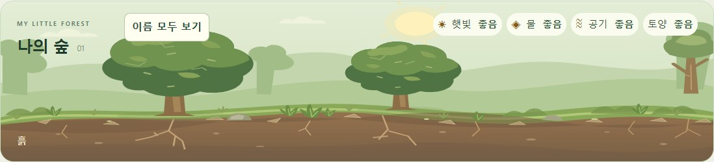 | 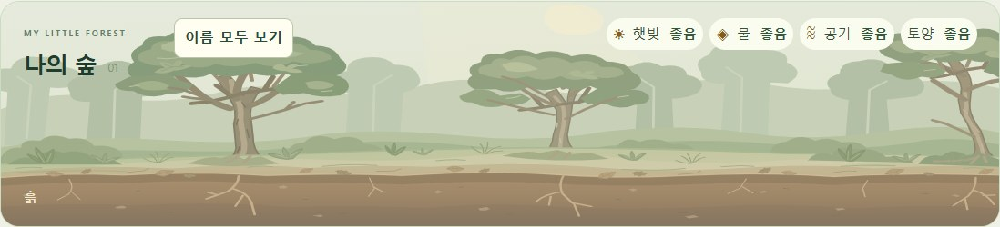 |
| B. 초기 5카드 숲 | 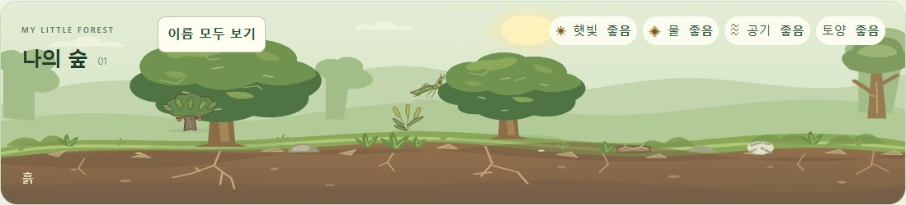 | 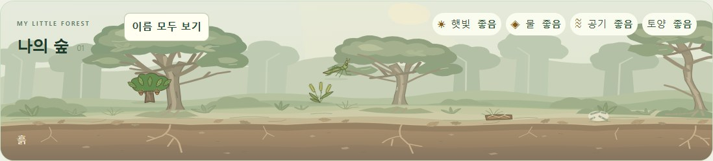 |
| C. 나무 이용 생물 | 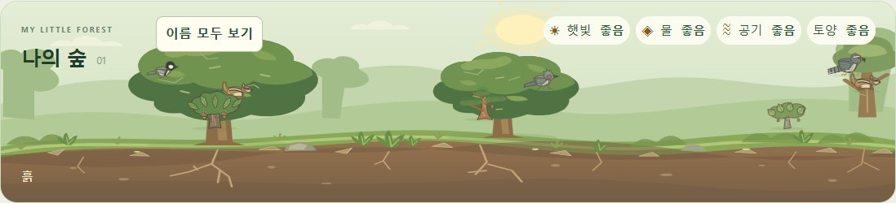 | 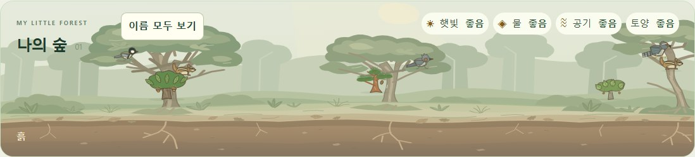 |
| D. 지상 생물 | 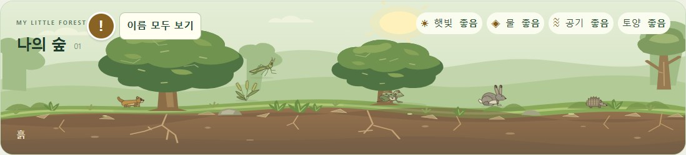 | 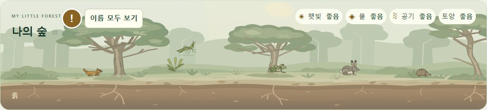 |
| E. 낙엽·토양 생물 | 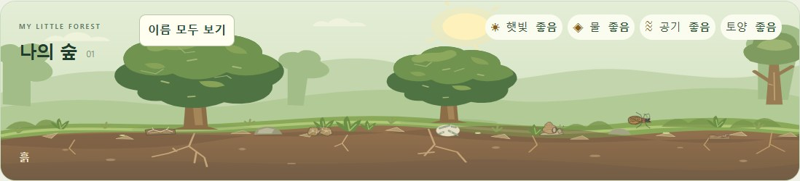 | 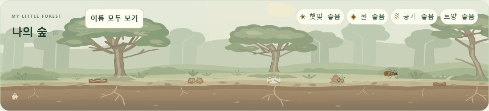 |
| F. 오른쪽 숲 | 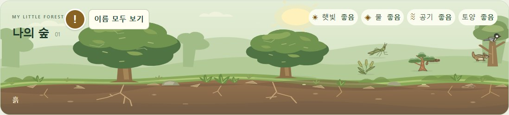 | 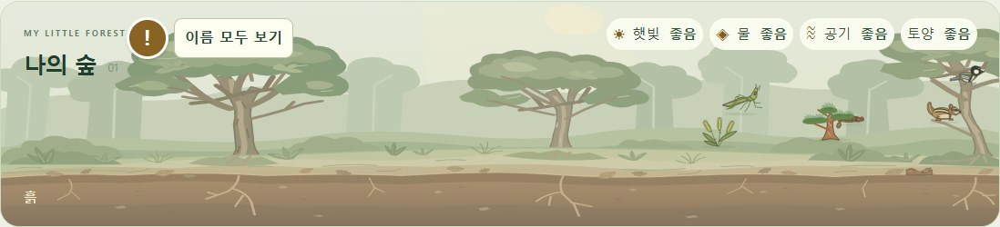 |
| G. 24종 30개체 | 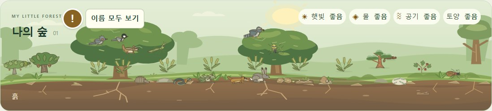 | 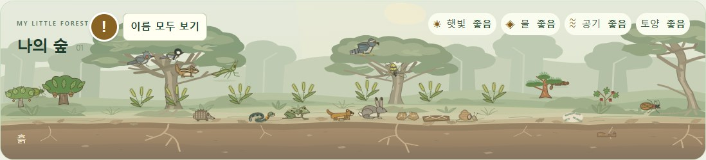 |

지지점 겹침 비교: [기존 배경](docs/forest-background/before-anchors.png) · [개선 배경](docs/forest-background/after-anchors.png). 16개 비교 그림은 검증 문서에서만 읽으며 게임 배경으로 중첩하지 않는다. 나머지5크기 원본·전체 게임 캡처와 실행 로그는 작업 공간 work/stage15_12_2-*에 보관했다.

## H. SVG·반응형 크기·성능

| 항목 | 이전 | 개선 |
|---|---:|---:|
| 숲 SVG 실제 UTF-8 파일 | 6,856bytes | 18,039bytes |
| 로컬 gzip 비교(실제 호스팅 전송량 보장 아님) | 2704bytes | 6946bytes |
| SVG 요소 수 | 99 | 165 |
| 필터/blur/외부 image/script/애니메이션 요소 | 0 | 0 |

레이어·독립 도형을 추가해 파일과 그리기 비용은 증가했다. 용량 증가를 품질의 근거로 삼지 않았다. 앞의 동일 장면·지지면·가독성 비교로 미술 결과를 평가했다. 실제 게임에서 바뀐 것은 정적 SVG 한 장이며, 별도 사진·PNG/WebP 중첩·새 타이머·배경 RAF는 없다. defs/use는 풀·낙엽의 반복 경로만 공유하고 주요 세 나무를 다시 같은 몸으로 복제하지 않는다.

| viewport | 변경 전 숲 내부 | 변경 후 숲 내부 | 선택 성공 | 화면 밖 개체 경계 | 심한 사각형 겹침 쌍 |
|---|---:|---:|---:|---:|---:|
| 1280×800 | 1238×333 | 1238×333 | 30/30 | 0 | 2 |
| 1138×712 | 1096×247 | 1096×247 | 30/30 | 0 | 4 |
| 960×600 | 930×224 | 930×224 | 30/30 | 0 | 2 |
| 1366×768 | 1324×301 | 1324×301 | 30/30 | 0 | 3 |
| 412×915 | 390×378 | 390×378 | 30/30 | 0 | 4 |

숲 영역 축소·새 가로 스크롤은 없었다. 기존 세로 페이지 스크롤은 유지한다. 겹침이 전혀 없는 것은 아니며 위 수치는 이미지 사각형 기준이다. 생물 이미지·CSS·투영은 같아서 배경 때문에 개체 경계나 hitbox가 바뀌지 않았다. 실제 픽셀 무늬의 동정 가능성과 선택 편의는 별도의 관찰 항목이다.

PC Edge/Chromium에서 각 그림/크기별11회 Image.decode, 매 회50번의 캐시된 canvas draw와 강제 read를 사용한 보조 측정을 했다. 일반 앱의 합성/캐싱·GPU 경로와 다른 인위적인 측정이므로 FPS로 환산하지 않는다.

| 그림 크기 | decode 중앙값 ms 전→후 | cached draw 중앙값 ms 전→후 |
|---|---:|---:|
| 1238×333 | 1.600 → 1.900 | 2.002 → 3.074 |
| 1096×247 | 1.500 → 1.800 | 1.498 → 2.404 |
| 930×224 | 1.600 → 1.900 | 1.262 → 2.050 |
| 1324×301 | 1.600 → 1.900 | 1.918 → 2.930 |
| 390×378 | 1.500 → 2.000 | 1.050 → 1.750 |

정적 그림의 보조 draw 비용은 위처럼 늘었다. 실제30개체 검사 구간에서는 pending RAF 최대1, 반복 layout 읽기0, interval0, 동일 DOM 유지true, 개체 DOM30이었다. S5e의 GPU·FPS·발열·전력·메모리 상한은 측정하지 않았다. 비교용 JPEG/PNG16개 총843,978bytes는 문서용이고 앱에서 로드하지 않는다.

## I. 기능·생태·저장 회귀

| 검사 | 최종 결과 |
|---|---|
| 전체 단위/생태 실행 | **1528통과, 실패0**; 10묶음 36/315/407/181/247/44/58/111/76/53 |
| 기존 브라우저 묶음 | 변경 전31/31, 변경 후31/31 |
| 새 배경 브라우저 | 35조건의 모델·표시·크기 동일, 6실제 지지면 접촉, 오류0 |
| 기존 생물 그래픽·FSM | 24자산/기본140뷰 래스터·15실제 먹기·분해3종·지렁이 피복/섭식·5크기·정지·저장 통과 |
| 장시간 생태 비교 | 20분/10분저장+10분/24종관리·무관리3시드, 총9쌍 **정확히 같음** |
| 실제 전체 숲 배치 | 24종×좌/중/우72배치,5크기, 실제 오른쪽 먹기/포식·식물/지렁이·저장 좌표 보존 |
| UI·학습 | 카드 선택 중 관찰 구분,3미션0/3→3/3,도감/먹이그물·반복 숲·권한/보상 회귀 통과 |
| 파일 보호 | 시작 tracked458개 중 453개 해시 동일; runtime121·생물SVG24·생성원본2·기존JSON120 포함 |

처음 단위 검사에서는 이전 tree translate/path 문자열을 찾던 한 항목만 실패했다. 새 배경은 독립 도형이므로 그 문자열을 숨겨 넣거나 옛 장식을 남기지 않고, viewBox·기존6중심·실제 support path 존재를 확인하도록 해당 한 항목을 갱신했다. 브라우저에서는 그 경로의 실제 stroke/fill 접촉까지 추가 검증한다. 생태/좌표/수용량/먹이/경제/저장 assert는 삭제하거나 느슨하게 하지 않았고 전체1528개를 다시 실행했다.

작업 재개 직후 첫 브라우저 시도는 종료된 로컬 서버 때문에 ERR_CONNECTION_REFUSED였다. 검사 도구의 그 실패와 최종 성공을 구분해 보관했다. 해당 미리보기 서버만 숨김으로 다시 실행한 뒤 전체31개를 재검사했다. 최종 수치와 성공 묶음은 서버가 정상인 실행에서 가져왔다.

24종/27먹이 관계, 최대30, 지렁이120/3, 포식·굶주림·성장·번식·수명·분해·환경 사건, 카드·미션·해금·초기0점·원장·환경 학습4점/최대5회·일회복구최대28점·느낌표 확인 무보상을 유지했다. schema17/ecology2/pacing1/goal1·2/eco-system:forest-save와7~16이전·미래 저장 차단, 왼쪽/오른쪽 실제 position 저장·복원, 공통 RAF와0.5초 tick도 변경하지 않았다. 관련 runtime121개는 바이트 해시가 동일하다.

새 결과 파일: [화면·모션·공간·성능](tests/forest-background.browser-results.json), [9개 결정적 생태 비교](tests/forest-background.ecology-results.json), [전체 회귀·보호 해시·변경 목록](tests/forest-background.regression-results.json). 과거 도구의 nested stage/schema fixture 라벨은 보존하고 이번 실행의 외부 stage15.12.2와 구분했다. 기존120개 결과JSON은 덮어쓰지 않았다.

재실행은 기존 node tests/run-tests.mjs에 새 TEST_RESULTS_DIR를 지정한다. 새 화면 검사는 tests/forest-background.browser.cjs의 before/after로 동일 장면을 캡처하고 새 RESULTS_PATH/SCREENSHOT_DIR와 BEFORE_RESULTS_PATH를 지정한다. BASE_URL은 정적 서버의 저장소 하위 경로를 사용하며 PLAYWRIGHT_MODULE/Edge가 필요하다. 실제 Pages 설정은 바꾸지 않았고 상대경로 로딩을 /eco-system/에서 확인했다.

## J. 남은 문제

- **Galaxy Tab S5e 실기기와 학생 검증 미실시**. 가로 화면의 주소창/회전/배율 변화,30개체 터치와 겹친 후보,20분 발열·프레임 유지,저장 복원 및 실제 학생이 작은 생물을 찾는 과제를 확인해야 한다.
- 기존 preserveAspectRatio=none/비등방 확대를 보호했으므로 **412px 세로 화면에서는 나무가 길고 가늘게 보인다**. 이 방식 변경은 anchor/projection과 함께 다루어야 하며 이번 단계에서 바꾸지 않았다. 가로 우선 방향을 유지한다.
- **좁은 세로 화면의 우측 조류가 낮은 지면 쪽으로 표시되는 기존 UI 회피 한계가 남는다**. 기존 projection을 고쳐 재배치하지 않았고 배경의 낮은 지지면/뿌리를 연결했다. 모든 화면의 새가 수관 가지에 정밀 착지한다고 보고하지 않는다.
- 혼잡할 때 넓은 임시 지지 영역과 실제 가지의 접촉이 매 프레임 정확한 것은 아니다. 이번6중심 검사·35정지 장면은 정밀 보행/비행/발 위치 모델의 대체가 아니다. 게임 좌표를 움직여 문제를 감추지 않았다.
- 30개체 숲의 겹침·작은 문양 가독성에는 기존 한계가 있다. 배경보다 생물이 앞에 그려지고 선택은 정상이어도 모든 무늬가 축소해서 읽히는 것은 아니다. 도감·이름 표시·기존 강조를 함께 사용한다.
- 생물의 종 동정 정확성과 명주달팽이/참지렁이의 이전 단계 미확정 사항은 그대로다. 이번 배경 작업으로 해결했다고 표시하지 않았다. 전문가/실제 학생의 생태 공간 이해 검토도 후속이다.

## K. GitHub 변경 내역

총 **27개** — 수정5,추가22,삭제0. 런타임 변경은 forest.svg 한 파일이고 나머지는 관련 검사·문서·비교 화면·새 결과다. 사용자 기존 미커밋 변경은 시작 시 없었다. stage/commit/push/branch/config/Pages 설정 변경은 하지 않았다.

- 수정: `ARCHITECTURE.md`
- 수정: `FOREST_SPATIAL_LAYOUT.md`
- 수정: `README.md`
- 수정: `assets/images/forest.svg`
- 수정: `tests/spatial.test.mjs`
- 추가: `STAGE15_12_2_FOREST_BACKGROUND_REDESIGN.md`
- 추가: `docs/forest-background-qa.html`
- 추가: `docs/forest-background/after-A-empty.jpg`
- 추가: `docs/forest-background/after-B-starter.jpg`
- 추가: `docs/forest-background/after-C-tree-users.jpg`
- 추가: `docs/forest-background/after-D-ground.jpg`
- 추가: `docs/forest-background/after-E-litter-soil.jpg`
- 추가: `docs/forest-background/after-F-right.jpg`
- 추가: `docs/forest-background/after-G-dense.jpg`
- 추가: `docs/forest-background/after-anchors.png`
- 추가: `docs/forest-background/before-A-empty.jpg`
- 추가: `docs/forest-background/before-B-starter.jpg`
- 추가: `docs/forest-background/before-C-tree-users.jpg`
- 추가: `docs/forest-background/before-D-ground.jpg`
- 추가: `docs/forest-background/before-E-litter-soil.jpg`
- 추가: `docs/forest-background/before-F-right.jpg`
- 추가: `docs/forest-background/before-G-dense.jpg`
- 추가: `docs/forest-background/before-anchors.png`
- 추가: `tests/forest-background.browser-results.json`
- 추가: `tests/forest-background.browser.cjs`
- 추가: `tests/forest-background.ecology-results.json`
- 추가: `tests/forest-background.regression-results.json`

GitHub Desktop Summary:

`Redesign the forest background around existing habitat anchors`

GitHub Desktop Description:

`Redraw the static forest with layered distance, three distinct trees, exposed resting branches, connected roots, a quiet clearing, leaf litter and soil. Preserve the existing viewBox, six habitat centers, projection, model positions and scene dimensions.`

`Keep all 24 species assets and 156 views, ecology, 27 food relations, placement, economy and schema17 saves unchanged. Add seven paired scene comparisons, anchor overlays and new regression evidence; update only the obsolete source-shape spatial assertion.`

`Validation: 1,528 tests; 31 browser suites before and after; 35 identical scene/viewport geometries; six drawn support contacts; nine exact long-run ecology comparisons; live motion and save checks. Document the increased static SVG cost and remaining narrow-portrait limitations. Real Galaxy Tab S5e and student testing remain pending.`
